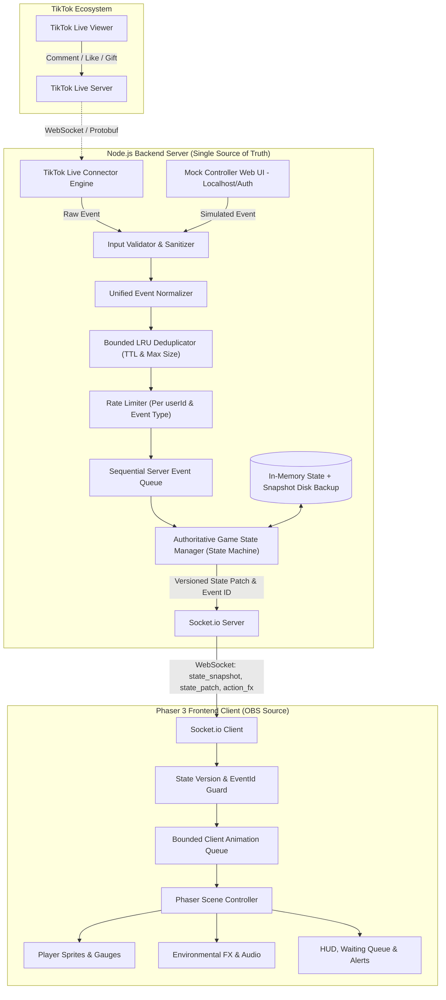
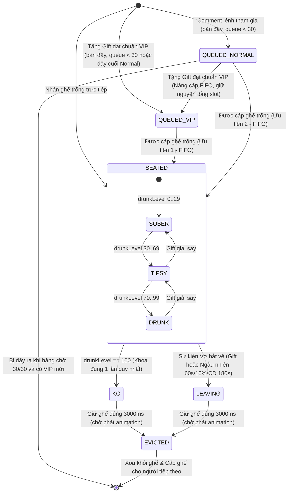

# TECHNICAL ARCHITECTURE: "1, 2, 3 DÔ!" (Master Plan v1.0 — LOCKED & APPROVED)

## 1. Sơ đồ Kiến trúc Tổng thể



## 2. Nguyên Tắc Kiến Trúc & Thiết Kế Thành Phần

### 2.1. Backend Là Nguồn Trạng Thái Duy Nhất (Authoritative Backend)
- **Single Source of Truth:** Toàn bộ trạng thái bàn nhậu, 6 ghế, hàng chờ ưu tiên, chỉ số say (`0–100`), bộ đếm cụng ly và sự kiện "Vợ bắt về" đều nằm tại Backend.
- **Frontend Stateless Render:** Phaser 3 Client chỉ đóng vai trò hiển thị trạng thái nhận từ Backend và phát hoạt ảnh. Không một animation hoặc sự kiện phía Client nào được phép tự ý thay đổi kết quả logic của Backend.

### 2.2. Player & Seat State Machine
Mỗi người chơi khi vào ghế tuân theo máy trạng thái hữu hạn (Finite State Machine) một chiều, đảm bảo không xảy ra xung đột (như vừa KO vừa được giải say, hoặc kích hoạt KO 2 lần):



- **Quy tắc bất biến của State Machine (Chính thức v1.0):**
  - Chỉ người chơi ở trạng thái `SEATED` mới nhận tác động tăng/giảm độ say (từ Hô DÔ `30s/+5`, Like `100/+1`, Gift) hoặc bị chọn bởi sự kiện "Vợ bắt về".
  - Khi đã chuyển sang `KO` hoặc `LEAVING`, người chơi bị **khóa trạng thái** (miễn nhiễm với mọi Gift giải say, Gift tăng say hoặc sự kiện tiếp theo).
  - **Kiểm tra mục tiêu tại thời điểm thực thi:** Nếu sự kiện Gift nhắm vào mục tiêu đã `KO`, `LEAVING` hoặc không còn ngồi trên bàn tại thời điểm `GameStateManager` xử lý: **không thay đổi độ say, không chuyển tác động sang người chơi khác**, chỉ phát thông báo/hiệu ứng hình ảnh (`stateChanged: false`) và ghi nhận `eventId` đã xử lý.
  - Hết thời gian giữ ghế `3000ms`, trạng thái chuyển sang `EVICTED`, giải phóng ghế về `null` và kích hoạt `assignNextFromQueue()`.

### 2.3. Pipeline Xử Lý Sự Kiện Tuần Tự (Event Pipeline)
1. **Input Validator & Sanitizer:**
   - Kiểm tra kiểu dữ liệu đầu vào, loại bỏ ký tự điều khiển HTML/script.
   - Giới hạn độ dài `userId` (`<= 64` ký tự), `nickname` (lưu tối đa `32` ký tự, cắt hiển thị `12` ký tự), `comment` (tối đa `100` ký tự).
2. **Unified Event Normalizer (`eventNormalizer.js`):**
   - Chuẩn hóa sự kiện từ cả `LIVE` (`tiktok-live-connector`) và `MOCK` (`mockService`) về một cấu trúc `NormalizedGameEvent` duy nhất.
   - Cấp phát `eventId` duy nhất (UUIDv4 hoặc bộ đếm kết hợp timestamp) cho mỗi sự kiện hợp lệ.
3. **Bounded Deduplicator (`deduplicator.js`):**
   - Sử dụng cấu trúc LRU Cache có **TTL** (ví dụ: `120 giây`) và **giới hạn số lượng phần tử tối đa** (ví dụ: `maxEntries = 5000`) để bảo vệ bộ nhớ.
   - Chống xử lý trùng lặp theo `eventId`, `msgId` và tổ hợp Gift streak `(userId, giftId, groupId, repeatCount)`.
4. **Rate Limiter (`rateLimiter.js`):**
   - Giới hạn tần suất theo cặp `(userId, eventType)` (ví dụ: lệnh tham gia/comment tối đa 1 lần / 3 giây mỗi `userId`).
   - Có cơ chế tự dọn dẹp (cleanup/eviction) các khóa hết hạn định kỳ để không rò rỉ bộ nhớ.
5. **Sequential Server Event Queue (`eventQueue.js`):**
   - Hàng đợi FIFO có giới hạn kích thước (`maxQueueLength = 1000`).
   - Xử lý tuần tự từng sự kiện một qua `GameStateManager`, loại bỏ hoàn toàn lỗi race condition khi nhiều sự kiện đến trong cùng một tick.

### 2.4. Animation Queue Có Giới Hạn Ở Client (`animationQueue.js`)
- Client duy trì hàng đợi hoạt ảnh có giới hạn cứng (ví dụ: `maxAnimationQueue = 20`).
- **Tách biệt Visual FX và Game State:** Trạng thái số liệu (ai ngồi ghế nào, độ say bao nhiêu) được cập nhật theo `stateVersion` từ Server; trong khi hiệu ứng hình ảnh (cụng ly, vợ kéo, thông báo quà) đi qua `AnimationQueue`.
- Khi lưu lượng sự kiện tăng đột biến vượt ngưỡng hàng đợi, Client tự động gộp hiệu ứng (batching) hoặc rút ngắn thời lượng hiệu ứng cũ để không gây trễ hình ảnh.

## 3. Cấu trúc Thư mục Dự án Dự kiến

```
D:\game/
├── package.json
├── PROJECT_MASTER_PLAN.md
├── TECHNICAL_ARCHITECTURE.md
├── GAME_DESIGN.md
├── IMPLEMENTATION_PLAN.md
├── PROJECT_STATUS.md
├── AGENTS.md
├── config/
│   └── default.json
├── data/
│   └── state-snapshot.json
├── server/
│   ├── index.js
│   ├── config.js
│   ├── services/
│   │   ├── tiktokService.js
│   │   ├── mockService.js
│   │   ├── gameStateManager.js
│   │   └── snapshotStore.js
│   ├── engines/
│   │   ├── inputValidator.js
│   │   ├── eventNormalizer.js
│   │   ├── deduplicator.js
│   │   ├── rateLimiter.js
│   │   └── eventQueue.js
│   └── socket/
│       └── socketHandler.js
├── client/
│   ├── index.html
│   ├── vite.config.js
│   ├── src/
│   │   ├── main.js
│   │   ├── config.js
│   │   ├── network/
│   │   │   └── socketClient.js
│   │   ├── scenes/
│   │   │   ├── BootScene.js
│   │   │   ├── TableScene.js
│   │   │   └── UIScene.js
│   │   ├── entities/
│   │   │   ├── SeatView.js
│   │   │   └── PlayerPlaceholder.js
│   │   └── managers/
│   │       ├── animationQueue.js
│   │       └── soundManager.js
│   └── public/
│       └── assets/
│           ├── sprites/
│           ├── audio/
│           └── fonts/
└── mock-dashboard/
    └── index.html
```

## 4. Cấu trúc Dữ liệu, State Versioning & Event Schema

### 4.1. Normalized Game Event
```typescript
interface NormalizedGameEvent {
  eventId: string;                     // ID duy nhất chống xử lý trùng
  source: 'LIVE' | 'MOCK';             // Nguồn phát sinh
  type: 'JOIN_CMD' | 'CHAT' | 'LIKE' | 'GIFT' | 'SYSTEM_CHEERS' | 'SYSTEM_WIFE';
  timestamp: number;
  user: {
    userId: string;                    // Khóa định danh duy nhất (Bắt buộc)
    nickname: string;                  // Đã cắt giới hạn & làm sạch
    avatarUrl: string;
  };
  payload: {
    comment?: string;
    likeDelta?: number;                // Số like tăng thêm đã chuẩn hóa
    totalLikeCount?: number;           // Tổng like tích lũy
    giftId?: number;                   // ID quà TikTok (ánh xạ qua bảng config)
    repeatCount?: number;
    repeatEnd?: boolean;
    streakId?: string;
    targetSeatIndex?: number;          // Ghế mục tiêu (0..5) nếu có
  };
}
```

### 4.2. Player & Queue Item Schema
```typescript
interface QueueItem {
  userId: string;                      // Khóa định danh duy nhất
  nickname: string;
  avatarUrl: string;
  priority: 'VIP' | 'NORMAL';          // Phân nhóm ưu tiên
  enqueuedAt: number;
}

interface Player {
  userId: string;                      // Khóa định danh duy nhất
  nickname: string;
  avatarUrl: string;
  seatIndex: number;                   // 0..5
  drunkLevel: number;                  // Số nguyên 0..100
  status: 'SEATED' | 'KO' | 'LEAVING'; // Trạng thái State Machine
  visualTier: 'SOBER' | 'TIPSY' | 'DRUNK' | 'KO';
  joinedAt: number;
  lastActiveAt: number;
  statusLockedUntil?: number;          // Timestamp hết 3s giữ ghế khi KO/LEAVING
}
```

### 4.3. Authoritative Game State (Kèm `stateVersion`)
```typescript
interface GameState {
  stateVersion: number;                // Số nguyên tăng đơn điệu (+1 mỗi lần đổi state)
  roomId: string;
  mode: 'MOCK' | 'LIVE';
  connectionStatus: 'CONNECTED' | 'RECONNECTING' | 'DISCONNECTED';
  seats: (Player | null)[];            // Mảng cố định 6 phần tử (index 0..5)
  waitingQueue: {
    vip: QueueItem[];
    normal: QueueItem[];
    maxSize: number;                   // Mặc định 30 (tổng vip.length + normal.length <= 30)
  };
  likeMetrics: {
    totalLikes: number;
    unconsumedLikes: number;           // Số dư Like (< 100) cộng dồn cho mốc tiếp theo
    milestoneStep: number;             // Chính thức: 100 (mỗi 100 Like mới = +1 độ say)
  };
  timers: {
    lastCheersAt: number;              // Chu kỳ chính thức: 30000ms (+5 độ say)
    lastRandomWifeCheckAt: number;     // Chu kỳ kiểm tra chính thức: 60000ms (xác suất 10%)
    randomWifeCooldownUntil: number;   // Cooldown chính thức: 180000ms
  };
}
```

## 5. Thiết Kế Hợp Đồng Sự Kiện Socket.io (Socket.io Contracts)

Mọi thông điệp từ Server gửi xuống Client đều đính kèm `stateVersion` và `eventId`.
- **Quy tắc kiểm tra tại Client:**
  - Nếu nhận `game:state_snapshot`: Gán trực tiếp `localStateVersion = payload.stateVersion` và đồng bộ toàn bộ màn hình.
  - Nếu nhận bản cập nhật từng phần (`game:state_patch`): Chỉ áp dụng nếu `payload.stateVersion > localStateVersion`; nếu phát hiện bị hụt version, Client gửi yêu cầu `client:request_snapshot` để lấy lại trạng thái đầy đủ.
  - Với sự kiện hoạt ảnh (`game:action_fx`): Kiểm tra `eventId` trong danh sách gần nhất của Client để không phát lặp hiệu ứng.

| Hướng | Tên Sự Kiện | Payload Chính | Mục Đích |
| :--- | :--- | :--- | :--- |
| **Server -> Client** | `game:state_snapshot` | `{ stateVersion, state: GameState }` | Đồng bộ toàn bộ trạng thái khi mới kết nối hoặc sau khi reconnect |
| **Server -> Client** | `game:state_patch` | `{ eventId, stateVersion, seats, waitingQueue, likeMetrics }` | Cập nhật trạng thái ghế, độ say, hàng chờ |
| **Server -> Client** | `game:action_fx` | `{ eventId, stateVersion, actionType, targets, meta }` | Kích hoạt hoạt ảnh (`CHEERS`, `DRINK`, `SOBER`, `KO`, `WIFE_DRAG`) |
| **Server -> Client** | `game:chat_bubble` | `{ eventId, seatIndex, message }` | Hiển thị bong bóng thoại trên ghế tương ứng |
| **Server -> Client** | `game:banner_notice` | `{ eventId, title, message, level }` | Hiển thị thông báo sự kiện |
| **Client -> Server** | `client:ready` | `{ clientType: 'obs' \| 'mock', lastStateVersion }` | Thông báo Client kết nối/kết nối lại để nhận Snapshot |
| **Client -> Server** | `client:request_snapshot` | `{ currentVersion }` | Yêu cầu đồng bộ lại Snapshot khi lệch `stateVersion` |
| **Mock -> Server** | `mock:trigger_event` | `{ token, rawEvent }` | Gửi sự kiện giả lập từ Mock Dashboard (yêu cầu xác thực) |

## 6. Xử Lý TikTok Live, Chống Trùng Lặp & Reconnect

### 6.1. Xử Lý Gift Streak & Like Tích Lũy
- **Gift Streak / Combo:**
  - Với Gift có `giftType === 1` (cho phép combo), lưu khóa `streakKey = ${userId}:${giftId}:${groupId}` vào bộ nhớ tạm.
  - Tính độ lệch số lượng quà thực tế: `deltaRepeat = currentRepeatCount - lastProcessedRepeatCount`. Chỉ nhân tác động với `deltaRepeat > 0` và cập nhật lại `lastProcessedRepeatCount`.
  - Với Gift đơn lẻ (`giftType !== 1`), kiểm tra trực tiếp `msgId` trong LRU Deduplicator.
- **Like Normalization & Milestone Accumulation:**
  - Khi nhận gói tin Like từ TikTok, chuẩn hóa ra số lượng tăng thêm hợp lệ `likeDelta` (nếu có `totalLikeCount`, lấy `Math.max(0, incomingTotal - currentTotalLikes)` kết hợp kiểm tra `eventId` để không bao giờ cộng trùng).
  - Cộng `likeDelta` vào `totalLikes`.
  - Nếu trên bàn có ít nhất 1 người chơi đang `SEATED`:
    - `totalAvailable = unconsumedLikes + likeDelta`
    - `milestones = Math.floor(totalAvailable / 100)`
    - `unconsumedLikes = totalAvailable % 100`
    - Nếu `milestones > 0`, tăng `milestones * 1` độ say cho toàn bộ người chơi đang `SEATED` (không áp dụng cho `KO`/`LEAVING`).
  - Nếu trên bàn không có người chơi nào ở trạng thái `SEATED`: giữ `unconsumedLikes = 0` và không kích hoạt tăng độ say.

### 6.2. Cơ Chế Reconnect An Toàn (Không Nhân Đôi Timer)
- **TikTok Stream Reconnect:**
  - Quản lý kết nối bằng trạng thái đơn nhất (`IDLE`, `CONNECTING`, `CONNECTED`, `RECONNECTING`).
  - Khi mất kết nối, sử dụng thuật toán Exponential Backoff có Jitter (`1s, 2s, 4s, 8s...` tối đa `60s`).
  - Các bộ đếm gameplay (`cheersTimer`, `randomWifeTimer`, `koHoldTimer`) thuộc về `GameStateManager` độc lập với kết nối TikTok; việc kết nối lại TikTok **không khởi tạo lại hay tạo bản sao timer**.
- **Socket.io Reconnect:**
  - Khi OBS Browser Source kết nối lại, Client phát `client:ready` -> Server gửi ngay `game:state_snapshot` kèm `stateVersion` mới nhất để Client vẽ lại đúng trạng thái hiện thời.

## 7. Bảo Mật, Quản Lý Cấu Hình & Quy Tắc Logging

### 7.1. Bảo Mật Mock Dashboard & Input
- **Giới hạn truy cập Mock Dashboard:**
  - Mặc định chỉ cho phép kết nối điều khiển từ `127.0.0.1` / `localhost`.
  - Yêu cầu đính kèm mã xác thực `ADMIN_SECRET_TOKEN` (cấu hình trong `.env`) đối với mọi lệnh thay đổi trạng thái hoặc kích hoạt sự kiện Mock.
- **Sanitization:** Cắt độ dài và lọc bỏ mã độc trong toàn bộ chuỗi văn bản (`nickname`, `comment`) trước khi đưa vào State hoặc phát xuống Client.

### 7.2. Quy Tắc Logging An Toàn
- Tuyệt đối **không ghi log** cookie, `sessionId`, `ttwid`, `ADMIN_SECRET_TOKEN` hoặc bất kỳ khóa xác thực nào ra console hay file log.
- Sử dụng logger có cấu trúc (Structured JSON Logging) với các mức `info`, `warn`, `error`.

## 8. Xử Lý Lỗi Nghiêm Trọng & Khôi Phục Trạng Thái Tiến Trình

### 8.1. Nguyên Tắc Với Unhandled Exception / Unhandled Rejection
- **Không coi việc bắt `uncaughtException` hoặc `unhandledRejection` là bảo đảm tiến trình Node.js có thể tiếp tục chạy an toàn**, vì trạng thái bộ nhớ có thể đã bị hỏng (corrupted state).
- **Quy trình xử lý chuẩn:**
  1. Bắt sự kiện lỗi nghiêm trọng để ghi log chi tiết nguyên nhân.
  2. Lưu khẩn cấp bản chụp trạng thái hiện tại (nếu cấu trúc state còn hợp lệ) ra đĩa.
  3. Đóng kết nối an toàn và kết thúc tiến trình (`process.exit(1)`).
  4. Giao cho trình quản lý tiến trình (PM2 / script giám sát tự khởi động lại) bật lại tiến trình sạch ngay lập tức.

### 8.2. Cơ Chế Lưu & Khôi Phục Snapshot (`snapshotStore.js`)
- Định kỳ khi có thay đổi quan trọng về ghế/hàng chờ (throttled mỗi `3–5 giây`), Backend ghi bất đồng bộ bản chụp `GameState` ra file tạm `data/state-snapshot.json` (theo cơ chế ghi file tạm rồi đổi tên atomic write).
- Khi tiến trình Backend khởi động lại, nếu file snapshot tồn tại và còn mới (ví dụ: trong vòng `15 phút` của cùng phiên live), hệ thống tự động nạp lại danh sách 6 ghế, độ say và hàng chờ để buổi livestream tiếp diễn mượt mà.
- **Chính sách Recovery chính thức (Bản ghi quyết định ngày `2026-11-06`):**
  - **Nội dung:** Khi khôi phục Game State từ snapshot, chỉ khôi phục trực tiếp người chơi đang ở trạng thái `SEATED` (`drunkLevel < 100`). Mọi người chơi đang ở trạng thái `KO` hoặc `LEAVING` phải được hoàn tất việc rời bàn ngay trong quá trình recovery: xóa khỏi ghế, không khởi tạo lại timer `3000ms`, không tạo timer mồ côi, không phát lại hiệu ứng `KO` hoặc `LEAVING` cũ cho frontend. Nếu hàng chờ có người, cấp ghế ngay theo thứ tự `VIP Queue` trước, `Normal Queue` sau (FIFO trong từng nhóm), không tạo `userId` trùng và cập nhật `stateVersion` cùng file snapshot nhất quán. Không thay đổi luật `KO`/`LEAVING` `3000ms` khi vận hành bình thường.
  - **Lý do:** Các bộ đếm `setTimeout` (`3000ms`) chỉ tồn tại trong bộ nhớ tiến trình cũ; việc hoàn tất rời bàn ngay khi recovery đảm bảo không bao giờ phát sinh ghế bị khóa chết bởi người đã rời bàn hoặc phát lại sự kiện cũ.
